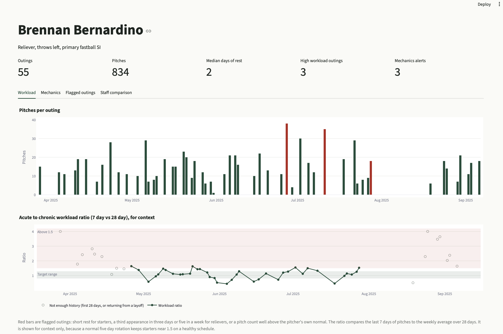

# Pitcher Workload and Mechanics Monitor

A web app and dashboard that track Boston Red Sox pitcher workload and flag changes in fastball velocity and release point that can signal fatigue. Built on public Statcast pitch data from Baseball Savant.

**Live app:** [add your Streamlit link]
**Dashboard:** [add your Tableau Public link]



## What it does

For each pitcher, the app shows:

- **Workload:** pitches per outing and days of rest, with short rest, heavy reliever usage, and unusually high pitch counts flagged, plus the acute to chronic workload ratio for context.
- **Mechanics:** average fastball velocity and release point for every outing, compared against the pitcher's own season range.
- **Flagged outings:** a table of every flagged outing and the reason.

The Tableau dashboard compares the whole staff side by side.

## How it works

```
Baseball Savant ──> pipeline.py ──> SQLite (data/workload.db) ──┬──> Streamlit app (app.py)
   (pybaseball)                     sql/outings.sql              └──> CSV exports ──> Tableau
```

1. `pipeline.py` pulls a season of Red Sox games, keeps regular season pitches thrown by Red Sox pitchers, and selects the top 10 by pitch count.
2. Pitches load into SQLite. `sql/outings.sql` uses window functions to build one row per outing with pitch count, days of rest, appearances in the last 3 and 7 days, 7 day and 28 day rolling load, and the workload ratio.
3. Python adds role aware workload flags and mechanics flags, comparing each outing to the pitcher's own season range.
4. The app and the dashboard both read from the same tables.

## Run it

```bash
python -m venv .venv
source .venv/bin/activate          # Windows: .venv\Scripts\activate
pip install -r requirements.txt

python pipeline.py                 # about 5 to 15 minutes the first time
streamlit run app.py
```

The first run saves the raw pull to `data/raw_statcast_2025.csv`, so later runs skip the download. Use `--refresh` to pull again, `--pitchers 12` to change how many pitchers are kept, or `--season 2024` for another year.

At the end, the pipeline prints the counts for the resume bullet: pitches loaded, outings, and flagged outings.

## Deploy the app

1. Push the repo to GitHub, including `data/workload.db` (the raw CSV is ignored, the database is small).
2. Go to share.streamlit.io, sign in with GitHub, and choose the repo with `app.py` as the main file.

## Build the dashboard

The pipeline writes two files to `data/exports/`:

- `outings.csv`: one row per pitcher per outing, with every metric and flag
- `staff_summary.csv`: one row per pitcher, with season totals and flag counts

**Tableau Public:** Connect to a text file, open `outings.csv`, and add `staff_summary.csv` as a second source. Suggested sheets:

1. Staff overview: a bar chart of high workload and mechanics flags per pitcher from `staff_summary.csv`
2. Workload over time: `game_date` on columns, `pitches` on rows, one chart per pitcher, colored by `high_load_flag`
3. Velocity trend: `fb_velo` by `game_date`, filtered by pitcher, with flagged outings colored by `velo_drop_flag`
4. Combine them into a dashboard with a pitcher filter and a role filter (starter or reliever), then publish to Tableau Public

**Power BI:** Get data from Text/CSV for both files, relate them on `name`, and build the same four visuals. Use a constant line at 1.5 on the ratio chart.

## Method notes

- **Workload flags.** Flags are role aware, the way pitching staffs think about usage. Starters are flagged for short rest (3 or fewer days). Relievers are flagged on a third appearance in three days or a fifth in seven days. Any pitcher is flagged when a pitch count is 2 standard deviations above his own season average. All thresholds are at the top of `pipeline.py`.
- **Workload ratio.** Acute load is pitches in the 7 days ending on an outing, and chronic load is pitches in the 28 days ending on that outing divided by 4. It's shown for context but not used as a flag. I first flagged ratios above 1.5, and it flagged about half of all healthy starts: on a normal five day rotation, most 7 day windows contain two starts, so the ratio sits near 1.5 on a normal schedule. The ratio was designed for daily training loads, not a few large game days. It's marked unreliable for a pitcher's first 28 days and for 28 days after 14 or more days off, since rehab outings aren't in Statcast.
- **Pitch counts only.** Game pitches are counted. Bullpen sessions, warmups, and minor league rehab outings are not in Statcast, so real workload is higher than shown.
- **Mechanics.** Only each pitcher's most thrown fastball (four seam, sinker, or cutter) is used, so changes in pitch mix don't look like drift. An outing needs at least 5 of those fastballs, and a pitcher needs at least 8 such outings before any flags are set.
- **Flags.** A velocity drop is 2 standard deviations below the pitcher's season average. Release drift is 2 standard deviations from his average release side or height. These thresholds are set at the top of `pipeline.py`.
- **Release point.** Statcast measures release position from the catcher's view, in feet.

## Data source

Pitch data from [Baseball Savant](https://baseballsavant.mlb.com), accessed with [pybaseball](https://github.com/jldbc/pybaseball). This is a personal project and is not affiliated with the Boston Red Sox or MLB.
